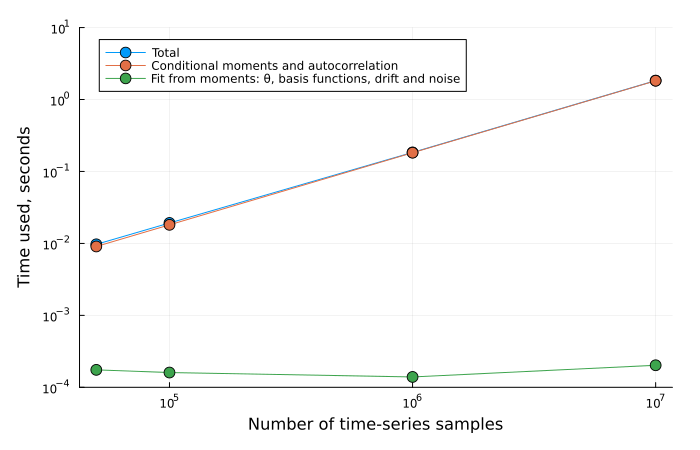
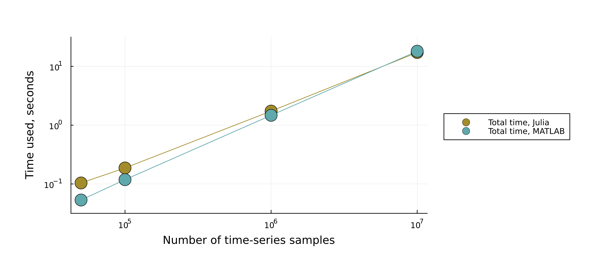

# ExponentialNoiseSDE

[](https://github.com/williamjsdavis/ExponentialNoiseSDE.jl/actions/workflows/CI.yml)

Regression of stochastic processes with exponentially correlated noise. `ExponentialNoiseSDE` is a `julia` package that estimates a stochastic differential equation driven by exponentially correlated (Ornstein-Uhlenbeck) noise,

```
dX/dt = f(X) + g(X) η(t),    dη = -η/θ dt + (1/θ) dW,
```

from a sampled time series: the drift `f`, the noise amplitude `g`, and the correlation time `θ` of the noise. The regression is flexible enough to account for white (`θ → 0`) or exponentially correlated noise. It employs a block bootstrap algorithm to estimate uncertainties.

This is a port of the `MATLAB` package [`secn-PR`](https://github.com/williamjsdavis/secn-PR).

# Installation

```julia
using Pkg
Pkg.add(url="https://github.com/williamjsdavis/ExponentialNoiseSDE.jl")
```

# Quick start

```julia
using ExponentialNoiseSDE, Random

observation = Observation(X, dt) # Time series X with time step dt
momentSettings = ConditionalMomentSettings(
    timeShiftSamplePoints = 1:15,
    evalPoints = range(-1.0, 1.0, length = 20),
    bandwidth = 0.1,
)
modelEstimate = estimate_model(observation, momentSettings, ModelEstimateSettings())
correlation_time(modelEstimate), eval_points(modelEstimate), drift(modelEstimate), noise(modelEstimate)

bootstrapStatistics = estimate_bootstrap_statistics(modelEstimate, BootstrapSettings(); rng=Xoshiro(1))
drift(bootstrapStatistics).lower95, drift(bootstrapStatistics).upper95
```

# Documentation

The documentation covers the model, the method, the options, known limitations and the API. Build it with

```sh
julia --project=docs -e 'using Pkg; Pkg.develop(path="."); Pkg.instantiate()'
julia --project=docs docs/make.jl
```

and open `docs/build/index.html`. A worked example, with figures, is in [`example/`](example/).

# Benchmarking

[`benchmark/scaling.jl`](benchmark/scaling.jl) times the estimation against the length of the series (how to run it is at the top of the script). Almost all of the time goes to computing the conditional moments and autocorrelation increments, in one pass over the series, so it grows linearly with the length of the series. Fitting the model to the moments takes about 0.2 ms, whatever the length. Julia 1.11, Apple M1, one thread:



Version 0.1.0 had a scaling comparable to the MATLAB package [`secn-PR`](https://github.com/williamjsdavis/secn-PR), as shown below. The MATLAB timings were measured separately, so the script cannot rerun this comparison.



# TODOs

- [x] Add observations from multiple data sources (with the same time step)
- [x] Implement arbitrary `timeShiftSamplePoints` vector
- [x] Implement arbitrary spatial evaluation points
- [x] Implement option of forcing a particular correlation time
- [ ] Add compatibility for combining observations of different time-steps
- [ ] Make a plotting function for the distribution of correlation times (the bootstrap samples are in `bootstrapStatistics.samples`)
- [ ] Add more kernel functions to the library
- [x] Remove the bias from joining blocks in the bootstrap

# Changelog

See [`CHANGELOG.md`](CHANGELOG.md).

# Citing

See [`CITATION.cff`](CITATION.cff).

# References

- Lehle, B., & Peinke, J. (2018). Analyzing a stochastic process driven by Ornstein-Uhlenbeck noise. Physical Review E, 97(1), 012113.
- Lamouroux, D., & Lehnertz, K. (2009). Kernel-based regression of drift and diffusion coefficients of stochastic processes. Physics Letters A, 373(39), 3507-3512.
- Kunsch, H. R. (1989). The jackknife and the bootstrap for general stationary observations. The annals of Statistics, 1217-1241.
