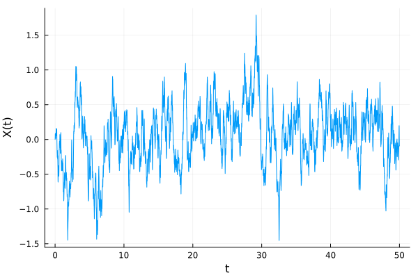
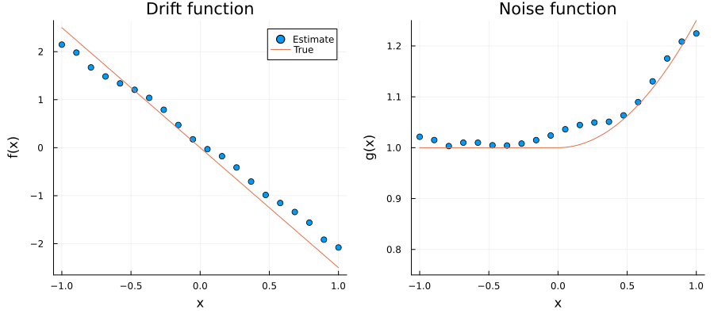
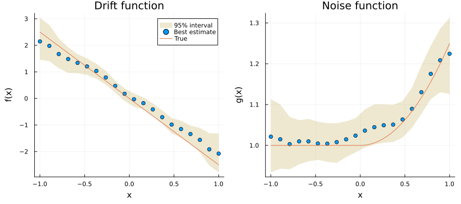

# Example

[`example.jl`](example.jl) estimates the model for the example data in
`test/data/exampleData.txt`, with bootstrap uncertainties, and writes the
figures below. From the repository root:

```sh
julia --project=example -e 'using Pkg; Pkg.develop(path="."); Pkg.instantiate()'
julia --project=example example/example.jl
```

The data are 50 000 samples of the model simulated with time step
`dt = 0.005`, correlation time `θ = 0.01`, drift `f(x) = -2.5x` and noise
`g(x) = 1 + x²/4` for `x > 0` (`g = 1` otherwise). They are the
`exampleDataB.txt` series from the MATLAB package
[`secn-PR`](https://github.com/williamjsdavis/secn-PR).



## Estimate

```julia
observation = Observation(X, 0.005)
momentSettings = ConditionalMomentSettings(
    timeShiftSamplePoints = 1:15,
    nEvalPoints = 20,
    evalLims = (-1.0, 1.0),
    bandwidth = 0.1,
)
modelEstimate = estimate_model(observation, momentSettings, ModelEstimateSettings())
```

```
ModelEstimate
  correlation time θ: 0.0102691
  evaluation points:  20 in [-1.0, 1.0]
  drift range:        (-2.079, 2.147)
  noise range:        (1.003, 1.224)
  iteration:          converged in 4 iteration(s)
  mean fit error:     6.892e-5
```

The estimated correlation time is within 3% of the true `θ = 0.01`.
`eval_points`, `drift` and `noise` give the estimates at each point:



## Bootstrap uncertainties

```julia
bootstrapStatistics = estimate_bootstrap_statistics(
    modelEstimate, BootstrapSettings(nSamples=200); rng=Xoshiro(1))
lower, upper = drift(bootstrapStatistics).lower95, drift(bootstrapStatistics).upper95
```



Each resample is made of blocks of consecutive windows of the series, so the
resampled estimates are centred on the best estimate. The intervals are
somewhat narrow: over series simulated from this model, 95% intervals for θ
cover the true value in about 83% of cases with the default settings, and
about 88% with 100 resamples (see "Known limitations" in the documentation).
